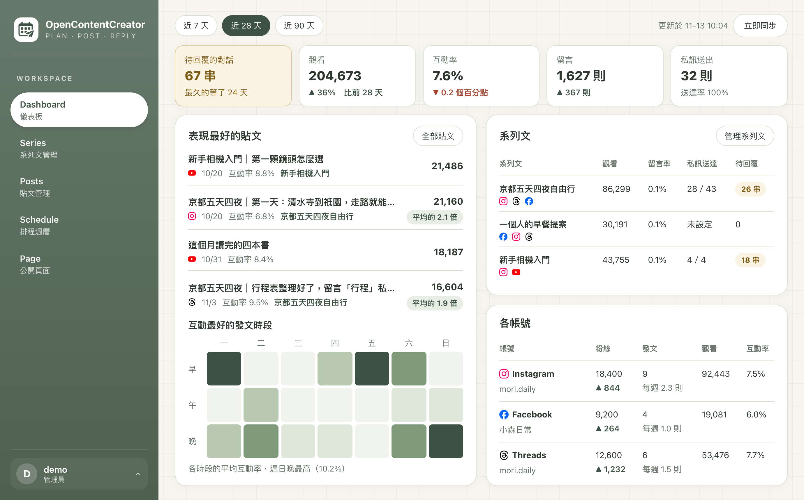
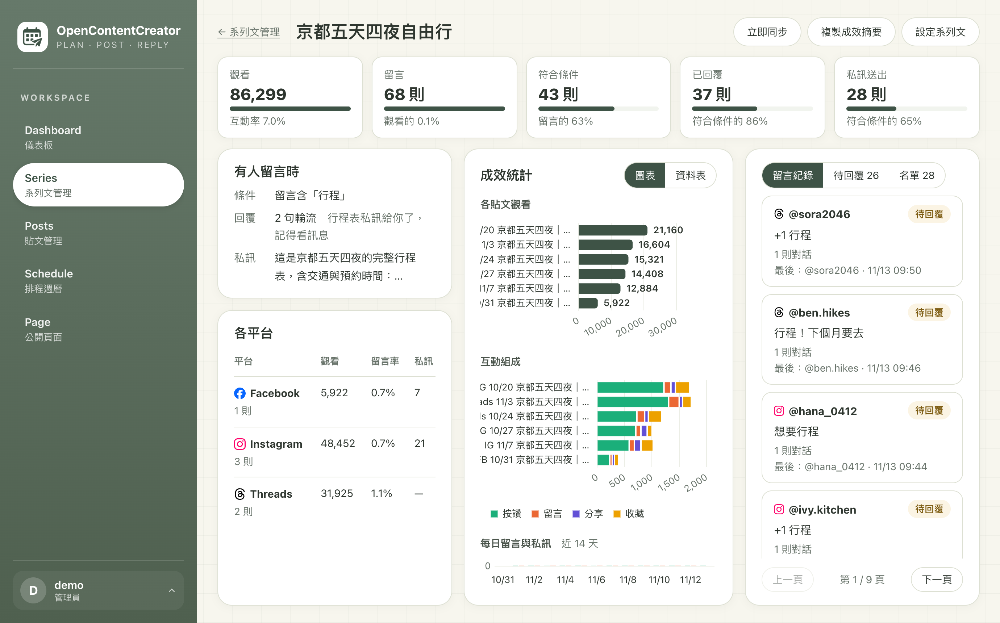
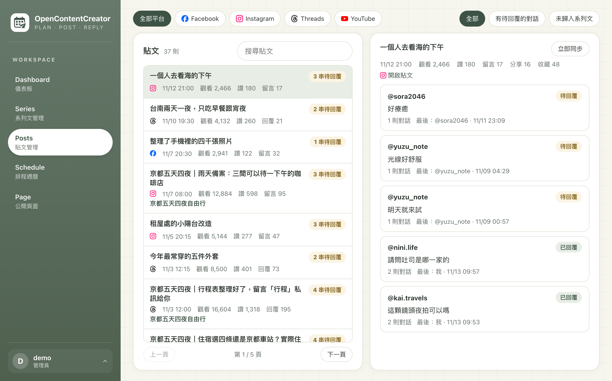
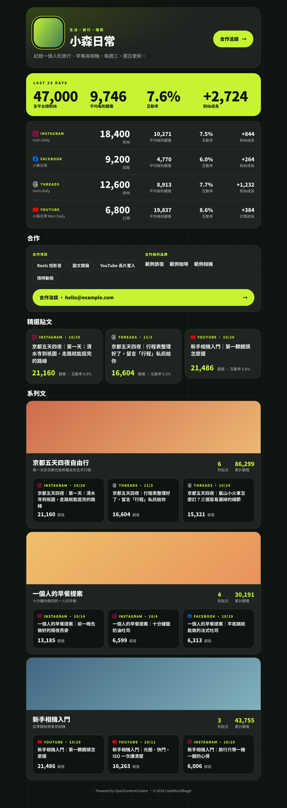

# OpenContentCreator

給自媒體創作者用的社群內容工具：把 Instagram、Facebook 粉專、Threads、YouTube 的貼文與成效收在一起，
有人留言時自動回覆並私訊，另外有一頁可以直接給廠商看的公開資料頁。

**這是自己架設的開源專案**（[MIT License](LICENSE)）：把程式拉下來，部署到你自己的 Cloudflare 帳號使用，不收費。
作者自己的站只供自用，沒有開放註冊。需要協助架設可以透過 <https://codeworldbagel.com> 聯絡作者。

系統**不代發貼文**：它管的是發文計畫、素材、留言與成效，貼文由你自己在各平台發。



畫面上的帳號、貼文與數字都是示範資料。

## 功能

| 畫面 | 內容 |
|---|---|
| 儀表板 | 待回覆的對話、觀看、互動率、留言、私訊送出；各帳號的粉絲數與增減、粉絲成長分析、表現最好的貼文、發文時段熱度圖 |
| 系列文 | 把貼文歸成一組，一起看成效（轉換漏斗、圖表、留言紀錄、拿到私訊的名單），並共用一套留言回覆設定 |
| 貼文管理 | 各平台已同步的貼文、底下的對話與手動回覆，可以用關鍵字搜尋 |
| 排程 | 自己新增規劃，或確認 AI 助理透過 MCP 送來的提案；撞期會標出來 |
| 公開頁面 | 每個會員一頁對外的資料頁（`/p/<代號>`），接業配時給廠商看：總粉絲、各平台數字、合作項目、精選貼文（可嵌入平台的貼文）、系列文 |
| 設定 | 帳號與平台連結、MCP 連線與提案、會員管理（從左下角的使用者選單打開） |
| 設定教學 `/guide` | 各平台怎麼建立應用程式、產生權杖、設定 Webhook |

### 畫面

| 系列文成效 | 貼文管理 |
|---|---|
|  |  |

公開頁面（給廠商看的資料頁）：



### 系列文與留言回覆

系列文是整個系統的中心：一組貼文（可以跨帳號、跨平台），一起看成效、共用一套回覆設定。

- 一則貼文只能屬於一個系列文。
- 有人在系列文裡的貼文留言 → 照設定回覆留言、私訊留言者；兩者各自有填才做。可以設定只有含關鍵字的留言才觸發。
- 不在系列文裡的貼文，留言只記錄、不自動回，可以在貼文管理手動回覆。
- 加入系列文之前就有的留言只會列為待送出，不會一口氣自動回覆。
- 只做「留言 → 回覆留言＋私訊」這一種情境，**不做私訊自動回覆**，也不接收別人傳來的私訊。

### 平台

Meta 的三個平台由每個會員用**自己的 Meta App** 產生權杖（只服務自己的帳號，不需要送審）；YouTube 走 Google OAuth，
用戶端由架站的人在 Google Cloud 申請。

| 平台 | 回覆留言 | 留言後私訊 | 成效同步 | 怎麼收到留言 |
|---|---|---|---|---|
| Instagram | ✓ | ✓ | ✓ | Webhook（即時） |
| Facebook 粉專 | ✓ | ✓ | ✓ | Webhook（即時） |
| Threads | ✓ | 平台不支援 | ✓ | 每 5 分鐘輪詢 |
| YouTube | ✓ | 平台不支援 | ✓ | 輪詢 |

Instagram 與 Facebook 粉專用真實帳號驗證過；Threads 與 YouTube 的部分流程目前只對著模擬的 API 測過。

### MCP

端點是 `/mcp`（Streamable HTTP）。每個專案有自己的權杖，只看得到所屬會員的資料：

```bash
claude mcp add --transport http opencontentcreator https://<你的網域>/mcp --header "Authorization: Bearer <權杖>"
```

工具：`list_accounts`、`list_schedule`、`find_open_slots`、`check_conflicts`、`get_insights`、
`get_follower_growth`、`compare_follower_periods`、`propose_post`、`update_proposal`。

### 會員

帳號加密碼登入，沒有開放註冊。每個會員的資料互相獨立，彼此看不到。
平常由管理員在「會員管理」建立帳號，密碼由系統產生、只顯示一次。

## 架構

Nuxt 4（`ssr: false` 的 SPA）+ Nitro `cloudflare_module`，整個跑在一個 Cloudflare Worker 上。

| Binding | 用途 |
|---|---|
| `DB`（D1） | 所有資料，schema 在 `server/database/schema.ts`（drizzle） |
| `MEDIA`（R2） | 素材與公開頁面的圖片 |

頁面由靜態資產直接回應，只有 `/api/*`、`/mcp`、`/p/*` 會進 Worker；另有兩個排程（每 5 分鐘、每 30 分鐘）。
時間一律是台北時間。設計上以 Workers Free 方案的限制為準（每個請求的 CPU 時間、對外請求與資料庫查詢次數）。

## 自己架設

需要 Cloudflare 帳號、Node.js 與 pnpm。`wrangler.jsonc` 裡的網域、資料庫 id 與儲存桶名稱是作者自己的，**要先換成你的**。

```bash
pnpm install
pnpm exec wrangler d1 create opencontentcreator          # 把回傳的 database_id 填進 wrangler.jsonc
pnpm exec wrangler r2 bucket create opencontentcreator-media
```

`wrangler.jsonc` 的 `routes` 改成你的網域，或整段拿掉改用 workers.dev 的網址。接著設定金鑰（不要寫進任何會 commit 的檔案）：

```bash
pnpm exec wrangler secret put NUXT_SESSION_PASSWORD   # session cookie 的加密密鑰，至少 32 字元
pnpm exec wrangler secret put NUXT_TOKEN_KEY          # 加密平台權杖的金鑰，至少 32 字元；換掉的話已連結的帳號都要重新連結
```

要連結 YouTube 的話，再加上 `NUXT_YOUTUBE_CLIENT_ID` 與 `NUXT_YOUTUBE_CLIENT_SECRET`（Google Cloud 的 OAuth 用戶端）。

```bash
pnpm exec wrangler d1 migrations apply DB --remote
pnpm build && pnpm exec wrangler deploy -c .output/server/wrangler.json
OCC_USER_PASSWORD='<密碼>' node scripts/set-user.mjs <帳號> --admin --remote   # 建立第一個管理員
```

登入之後照站內的 `/guide` 連結各平台。之後更新版本：有 schema 變更時先套用 migration，再建置與部署。

## 開發

```bash
pnpm install
pnpm db:migrate:local
pnpm build
OCC_USER_PASSWORD='<本機密碼>' node scripts/set-user.mjs <帳號> --admin
pnpm preview:worker --var NUXT_SESSION_PASSWORD:<32 字元以上>
```

在 workerd 上跑建置後的 Worker（<http://localhost:3010>），行為跟部署後一致。
改 schema：`pnpm db:generate --name <名稱>` 產生 migration。

## 授權

以 [MIT License](LICENSE) 釋出。
